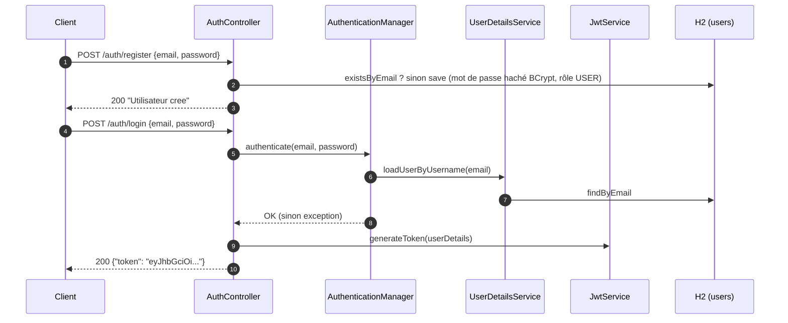
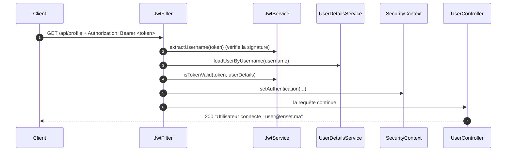

# 🔐 TP JWT Spring — API REST sécurisée par JSON Web Token

API REST **stateless** développée avec **Spring Boot** et **Spring Security**, qui illustre l'authentification par **JWT (JSON Web Token)** : inscription, connexion, génération du token, puis accès à des endpoints protégés via l'en-tête `Authorization: Bearer <token>`.

> Projet réalisé dans le cadre d'un TP à l'**ENSET Mohammedia** — package `ma.enset.tp_jwt_spring`.

---

## 📑 Table des matières

1. [Objectifs pédagogiques](#-objectifs-pédagogiques)
2. [Stack technique](#-stack-technique)
3. [Architecture du projet](#-architecture-du-projet)
4. [Fonctionnement de l'authentification](#-fonctionnement-de-lauthentification)
5. [Description des composants](#-description-des-composants)
6. [API : endpoints](#-api--endpoints)
7. [Configuration](#-configuration)
8. [Prérequis et lancement](#-prérequis-et-lancement)
9. [Tester l'API](#-tester-lapi)
10. [Console H2](#-console-h2)
11. [Points de sécurité et limites connues](#-points-de-sécurité-et-limites-connues)
12. [Pistes d'amélioration](#-pistes-damélioration)
13. [Dépannage](#-dépannage)
14. [Ressources](#-ressources)

---

## 🎯 Objectifs pédagogiques

- Comprendre la structure d'un JWT (header / payload / signature) et son rôle dans une API stateless.
- Configurer Spring Security **sans session** (`STATELESS`) et **sans CSRF** pour une API REST.
- Hacher les mots de passe avec **BCrypt**.
- Implémenter un **filtre personnalisé** (`OncePerRequestFilter`) qui valide le token à chaque requête.
- Générer et vérifier un token signé **HMAC** avec la bibliothèque **jjwt**.
- Protéger des routes (`/api/**`) et en laisser d'autres publiques (`/auth/**`).

---

## 🧰 Stack technique

| Élément | Version / détail |
|---|---|
| Langage | Java **21** |
| Framework | Spring Boot **4.1.1** (`spring-boot-starter-parent`) |
| Web | `spring-boot-starter-webmvc` |
| Sécurité | `spring-boot-starter-security` |
| Persistance | `spring-boot-starter-data-jpa` (Hibernate) |
| Base de données | **H2** en mémoire (`spring-boot-h2console` pour la console web) |
| JWT | **jjwt** `0.13.0` (`jjwt-api`, `jjwt-impl`, `jjwt-jackson`) |
| Boilerplate | **Lombok** (annotations `@Data`, `@NoArgsConstructor`, `@AllArgsConstructor`) |
| Build | Maven (wrapper `mvnw` / `mvnw.cmd`, Maven 3.10.0) |

---

## 🗂️ Architecture du projet

```
tp-jwt-spring/
├── pom.xml                         # Dépendances et configuration Maven
├── mvnw / mvnw.cmd                 # Maven Wrapper (Linux/macOS | Windows)
├── requests.http                   # Scénario de requêtes prêtes à l'emploi
├── HELP.md                         # Aide générée par Spring Initializr
├── .mvn/wrapper/                   # Configuration du Maven Wrapper
├── .github/modernize/              # Scripts d'outillage (mise à niveau Java), non liés à l'appli
└── src/
    ├── main/
    │   ├── java/ma/enset/tp_jwt_spring/
    │   │   ├── TpJwtSpringApplication.java        # Point d'entrée Spring Boot
    │   │   ├── config/
    │   │   │   └── SecurityConfig.java            # Chaîne de filtres, BCrypt, AuthenticationManager
    │   │   ├── controller/
    │   │   │   ├── AuthController.java            # /auth/register, /auth/login
    │   │   │   └── UserController.java            # /api/hello, /api/profile (protégés)
    │   │   ├── dto/
    │   │   │   ├── RegisterRequest.java           # { email, password }
    │   │   │   ├── LoginRequest.java              # { email, password }
    │   │   │   └── AuthResponse.java              # { token }
    │   │   ├── entity/
    │   │   │   └── AppUser.java                   # Entité JPA (table "users")
    │   │   ├── repository/
    │   │   │   └── UserRepository.java            # Accès aux données (Spring Data JPA)
    │   │   ├── security/
    │   │   │   └── JwtFilter.java                 # Filtre de validation du token
    │   │   └── service/
    │   │       ├── JwtService.java                # Génération / validation des JWT
    │   │       └── CustomerUserDetailsServiceImpl.java  # Chargement de l'utilisateur
    │   └── resources/
    │       └── application.properties             # Configuration (H2, JPA, JWT)
    └── test/
        └── java/ma/enset/tp_jwt_spring/
            └── TpJwtSpringApplicationTests.java   # Test généré par défaut
```

---

## 🔄 Fonctionnement de l'authentification

### 1. Inscription et connexion



### 2. Accès à une ressource protégée



Si l'en-tête est absent ou le token invalide / expiré / mal signé, le filtre **n'authentifie personne** et laisse la requête continuer : Spring Security refuse alors l'accès aux routes `/api/**` (réponse 401/403 selon la configuration).

### 3. Structure du token généré

| Partie | Contenu |
|---|---|
| **Header** | Algorithme HMAC-SHA (HS256 pour une clé de 256 bits) |
| **Payload** | `sub` = email de l'utilisateur, `iat` = date d'émission, `exp` = date d'expiration |
| **Signature** | HMAC calculé avec la clé secrète `jwt.secret` |

Durée de vie par défaut : **1 heure** (`jwt.expiration=3600000` ms).

---

## 🧩 Description des composants

### `SecurityConfig`
- Déclare le bean `PasswordEncoder` (**BCrypt**).
- Expose l'`AuthenticationManager` utilisé par `/auth/login`.
- Définit la `SecurityFilterChain` :
  - CSRF **désactivé** (API REST stateless) ;
  - sessions **STATELESS** ;
  - `/auth/**` et `/h2-console/**` → accès **public** ;
  - `/api/**` → **authentification requise** ;
  - toute autre requête → autorisée ;
  - `frameOptions().sameOrigin()` pour permettre l'affichage de la console H2 (iframe) ;
  - `JwtFilter` inséré **avant** `UsernamePasswordAuthenticationFilter`.

### `JwtFilter` (`OncePerRequestFilter`)
1. Lit l'en-tête `Authorization` et vérifie le préfixe `Bearer `.
2. Extrait le token et le nom d'utilisateur (subject).
3. Charge l'utilisateur en base, vérifie le token (utilisateur + expiration).
4. Place l'authentification dans le `SecurityContext`.
5. Toute exception (signature invalide, token expiré…) est interceptée : la requête continue **sans** authentification.

### `JwtService`
- `generateToken(UserDetails)` : crée un JWT signé (subject, date d'émission, expiration).
- `extractUsername`, `extractAllClaims` : lisent le payload après **vérification de la signature**.
- `isTokenValid` : compare l'utilisateur et contrôle l'expiration.
- La clé est lue en **Base64** depuis `jwt.secret` puis convertie via `Keys.hmacShaKeyFor`.

### `CustomerUserDetailsServiceImpl`
Implémente `UserDetailsService` : recherche l'`AppUser` par email et le convertit en `UserDetails` Spring Security (username, mot de passe haché, rôle).

### `AuthController`
- `register` : refuse un email déjà utilisé, hache le mot de passe, attribue le rôle `USER`, enregistre.
- `login` : authentifie via l'`AuthenticationManager` puis retourne un `AuthResponse` contenant le token.

### `UserController`
Deux endpoints d'exemple, accessibles uniquement avec un token valide.

### `AppUser` (table `users`)

| Champ | Type | Contraintes |
|---|---|---|
| `id` | `Long` | clé primaire, auto-incrémentée |
| `email` | `String` | **unique** |
| `password` | `String` | haché (BCrypt) |
| `role` | `String` | `USER` par défaut à l'inscription |

---

## 🌐 API : endpoints

| Méthode | URL | Accès | Corps de la requête | Réponse |
|---|---|---|---|---|
| `POST` | `/auth/register` | Public | `{"email": "...", "password": "..."}` | `200` « Utilisateur cree » ou `400` « Email deja utilise » |
| `POST` | `/auth/login` | Public | `{"email": "...", "password": "..."}` | `200` `{"token": "<jwt>"}` |
| `GET` | `/api/hello` | 🔒 Token requis | — | `200` « Bienvenue dans l'API securisee » |
| `GET` | `/api/profile` | 🔒 Token requis | — | `200` « Utilisateur connecte : <email> » |
| `GET` | `/h2-console` | Public | — | Console web H2 |

---

## ⚙️ Configuration

Fichier : `src/main/resources/application.properties`

| Propriété | Valeur par défaut | Rôle |
|---|---|---|
| `spring.application.name` | `tp-jwt-spring` | Nom de l'application |
| `spring.datasource.url` | `jdbc:h2:mem:securitydbdemo` | Base H2 **en mémoire** |
| `spring.datasource.username` / `password` | `sa` / *(vide)* | Identifiants H2 |
| `spring.jpa.hibernate.ddl-auto` | `update` | Création/mise à jour auto du schéma |
| `spring.jpa.show-sql` | `true` | Affiche les requêtes SQL dans les logs |
| `spring.h2.console.enabled` | `true` | Active la console H2 |
| `spring.h2.console.path` | `/h2-console` | URL de la console |
| `jwt.secret` | clé **Base64** (256 bits) | Clé de signature des tokens |
| `jwt.expiration` | `3600000` | Durée de validité en ms (1 h) |

### Générer votre propre clé secrète

```bash
openssl rand -base64 32
```

Collez le résultat dans `jwt.secret` (ou, mieux, passez-le par variable d'environnement : `JWT_SECRET`, voir plus bas).

---

## 🚀 Prérequis et lancement

### Prérequis
- **JDK 21**
- Aucun besoin d'installer Maven : le wrapper `mvnw` est fourni.
- Un client HTTP : `curl`, Postman, ou l'extension **REST Client** de VS Code (fichier `requests.http`).

### Lancement

```bash
# Linux / macOS
./mvnw spring-boot:run

# Windows
mvnw.cmd spring-boot:run
```

L'application démarre sur **http://localhost:8080**.

### Autres commandes utiles

```bash
./mvnw clean package          # Compiler et générer le JAR
./mvnw test                   # Lancer les tests
java -jar target/tp-jwt-spring-0.0.1-SNAPSHOT.jar
```

### Surcharger la configuration sans modifier le fichier

```bash
JWT_SECRET="votre_cle_base64" JWT_EXPIRATION=1800000 ./mvnw spring-boot:run
```

(Spring Boot mappe `JWT_SECRET` vers `jwt.secret` et `JWT_EXPIRATION` vers `jwt.expiration`.)

---

## 🧪 Tester l'API

### Avec `curl`

**1. Inscription**
```bash
curl -X POST http://localhost:8080/auth/register \
  -H "Content-Type: application/json" \
  -d '{"email":"user@enset.ma","password":"1234"}'
```

**2. Connexion — récupérer le token**
```bash
curl -X POST http://localhost:8080/auth/login \
  -H "Content-Type: application/json" \
  -d '{"email":"user@enset.ma","password":"1234"}'
# => {"token":"eyJhbGciOiJIUzI1NiJ9..."}
```

**3. Appel sans token → refusé**
```bash
curl -i http://localhost:8080/api/hello
# => 401 / 403
```

**4. Appel avec token → autorisé**
```bash
TOKEN="eyJhbGciOiJIUzI1NiJ9..."   # coller le token reçu

curl http://localhost:8080/api/hello   -H "Authorization: Bearer $TOKEN"
curl http://localhost:8080/api/profile -H "Authorization: Bearer $TOKEN"
```

### Avec `requests.http` (VS Code / IntelliJ)

Le fichier `requests.http` à la racine contient les 5 requêtes du scénario complet (inscription, connexion, accès sans token, accès avec token, profil). Remplacez `<TOKEN>` par le token obtenu à l'étape 2.

### Scénarios de test recommandés

| Scénario | Résultat attendu |
|---|---|
| Inscription d'un nouvel email | `200` |
| Inscription du même email deux fois | `400` « Email deja utilise » |
| Connexion avec bons identifiants | `200` + token |
| Connexion avec mauvais mot de passe | Échec d'authentification (pas de token) |
| `/api/hello` sans token | `401` / `403` |
| `/api/hello` avec token valide | `200` |
| `/api/hello` avec token modifié (1 caractère changé) | Refusé (signature invalide) |
| `/api/hello` avec token expiré | Refusé |

> 💡 Astuce : collez votre token sur [jwt.io](https://jwt.io) pour inspecter son header et son payload. N'y collez jamais de token de production.

---

## 🗄️ Console H2

1. Ouvrir **http://localhost:8080/h2-console**
2. Renseigner :
   - **JDBC URL** : `jdbc:h2:mem:securitydbdemo`
   - **User Name** : `sa`
   - **Password** : *(vide)*
3. Exécuter `SELECT * FROM users;` pour constater que les mots de passe sont stockés **hachés** (préfixe `$2a$...`).

> La base étant **en mémoire**, toutes les données sont perdues à chaque redémarrage de l'application.

---

## 🛡️ Points de sécurité et limites connues

Ce projet est un **support de TP** : plusieurs choix sont volontairement simples et **ne doivent pas être repris tels quels en production**.

| Sujet | Constat | Risque / remarque |
|---|---|---|
| **Secret JWT** | Écrit en clair dans `application.properties` | Versionné dans Git = compromis. À externaliser (variable d'environnement, vault) et à régénérer. |
| **Console H2** | Publique (`/h2-console/**` en `permitAll`) et `frameOptions` en `sameOrigin` | À désactiver hors développement. |
| **CSRF désactivé** | Cohérent pour une API stateless avec token en en-tête | Ne pas stocker le JWT dans un cookie sans réactiver des protections. |
| **Validation des entrées** | Aucune (email vide, mot de passe vide ou faible acceptés) | Ajouter `spring-boot-starter-validation` et des contraintes (`@Email`, `@NotBlank`, taille minimale…). |
| **Rôles** | Stockés en base mais non utilisés pour restreindre l'accès (`/api/**` = simplement « authentifié ») | Ajouter `hasRole(...)` ou `@PreAuthorize` pour une vraie autorisation. |
| **Gestion des erreurs** | Pas de `@ControllerAdvice` : un mauvais login n'est pas traduit en `401` propre | Prévoir des réponses JSON homogènes. |
| **Règle finale** | `anyRequest().permitAll()` | Préférer `anyRequest().denyAll()` ou `authenticated()` (principe du moindre privilège). |
| **Token unique** | Pas de refresh token, pas de révocation / déconnexion côté serveur | Un token volé reste valable jusqu'à son expiration. |
| **Messages d'erreur** | « Email deja utilise » à l'inscription | Permet l'énumération de comptes. |
| **Exemple de mot de passe** | `1234` dans `requests.http` | Uniquement pour la démonstration. |
| **Tests** | Un seul test généré par défaut | Ajouter des tests d'intégration (`MockMvc`) sur le flux complet. |

---

## 🔭 Pistes d'amélioration

- [ ] Externaliser `jwt.secret` (variable d'environnement / vault) et le retirer de l'historique Git
- [ ] Ajouter la **validation** des DTO (Bean Validation)
- [ ] Inclure le **rôle** dans les claims du JWT et sécuriser par rôle (`ADMIN` / `USER`)
- [ ] Gérer les erreurs avec un `@RestControllerAdvice` et un `AuthenticationEntryPoint` personnalisé (401 JSON)
- [ ] Implémenter un **refresh token** et une liste de révocation
- [ ] Remplacer H2 par **PostgreSQL / MySQL** avec profils Spring (`dev`, `prod`)
- [ ] Documenter l'API avec **springdoc-openapi (Swagger UI)**
- [ ] Ajouter des **tests d'intégration** (MockMvc / Testcontainers)
- [ ] Conteneuriser avec **Docker** et ajouter une CI (GitHub Actions)
- [ ] Limiter les tentatives de connexion (rate limiting / verrouillage temporaire)

---

## 🩺 Dépannage

| Problème | Cause probable | Solution |
|---|---|---|
| `Unsupported class file major version` | JDK inférieur à 21 | Installer JDK 21 et vérifier `java -version` |
| `Port 8080 was already in use` | Port occupé | Libérer le port ou lancer avec `--server.port=8081` |
| `WeakKeyException` au démarrage / login | Clé JWT < 256 bits | Générer une clé avec `openssl rand -base64 32` |
| `403` malgré un token | En-tête mal formé ou token expiré | Vérifier le format `Authorization: Bearer <token>` (avec l'espace) et la date d'expiration |
| Les getters/setters Lombok sont introuvables dans l'IDE | Annotation processing désactivé | Activer l'*annotation processing* et installer le plugin Lombok |
| La console H2 ne s'affiche pas | Mauvaise URL JDBC | Utiliser exactement `jdbc:h2:mem:securitydbdemo` |
| Utilisateurs disparus après redémarrage | Base H2 en mémoire | Comportement normal ; passer à une base persistante si besoin |

---

## 📚 Ressources

- [Spring Security — documentation officielle](https://docs.spring.io/spring-security/reference/)
- [Spring Boot Reference](https://docs.spring.io/spring-boot/4.1.1/reference/)
- [jjwt — dépôt GitHub](https://github.com/jwtk/jjwt)
- [RFC 7519 — JSON Web Token](https://datatracker.ietf.org/doc/html/rfc7519)
- [jwt.io — débogueur de tokens](https://jwt.io)
- [OWASP — JWT Cheat Sheet](https://cheatsheetseries.owasp.org/cheatsheets/JSON_Web_Token_for_Java_Cheat_Sheet.html)

---

